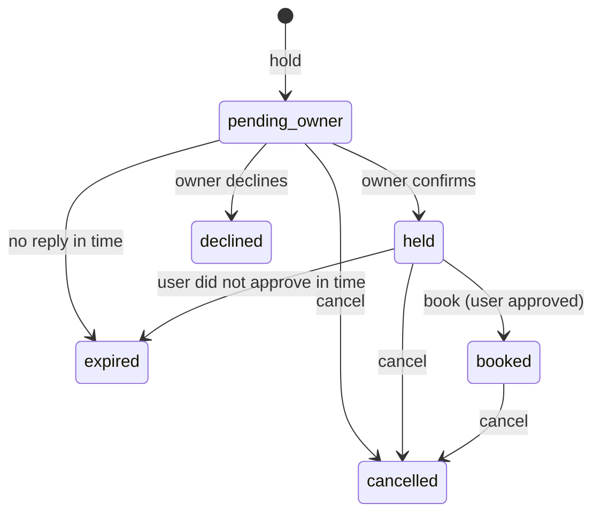

# Browser Proxy Twin protocol (v0.1)

A small, open protocol that lets an agent discover a business and book it without any web page. It has three parts: the **agent card**, **five messages**, and a few **error codes**. Everything is JSON over HTTP. The card shape deliberately resembles an A2A-style agent card so adapters stay simple.

## 1. Agent card

A business publishes one card. The directory validates it and assigns an `id`.

```json
{
  "schema": "proxytwin/0.1",
  "name": "Priya Ladies Salon",
  "category": "salon",
  "area": "Gandhipuram",
  "city": "Coimbatore",
  "languages": ["Tamil", "English"],
  "services": [
    {"name": "Haircut", "price_inr": 200},
    {"name": "Facial", "price_inr": 500}
  ],
  "hours": {"open": "10:00", "close": "20:00"},
  "slot_minutes": 60,
  "closed_days": ["Monday"],
  "required_documents": []
}
```

| Field | Type | Required | Notes |
|---|---|---|---|
| `schema` | string | set by directory | `proxytwin/0.1` |
| `name` | string | yes | Business name |
| `category` | string | yes | Lower-cased, e.g. `salon`, `clinic`, `kirana`, `office`, `tailor`, `dentist` |
| `area` | string | yes | Locality; searched by substring |
| `city` | string | no | |
| `languages` | list of strings | no | Default `["English"]` |
| `services` | list | yes | Each needs `name` and `price_inr` (number, 0 or more). The first service is the default |
| `hours` | object | yes | `open` and `close` in 24-hour `HH:MM`; `open` must be earlier than `close` |
| `slot_minutes` | integer | no | 5 to 240, default 60 |
| `closed_days` | list | no | Weekday names, e.g. `["Sunday"]` |
| `required_documents` | list of strings | no | Shown to the user before booking |

Unknown extra fields are kept, so a card can carry extra information. Cards contain **no personal phone numbers**; the owner channel is configured by the hosting service.

## 2. Discovery

| Request | Result |
|---|---|
| `POST /cards` with a card | `201 {"id", "card"}` or an error |
| `GET /cards?category=salon&area=Gandhi&language=Tamil` | `{"cards": [{"id", ...card}]}` (all filters optional) |
| `GET /cards/<id>` | one card |

## 3. The five messages

Sent as `POST /agents/<id>/message` with a JSON body. Replies are JSON; failures use the error format in section 4.

### `query`: what can you offer on this date?

```json
{"type": "query", "date": "2026-11-25", "service": "Haircut"}
```
Reply:
```json
{"type": "offer", "shop": "Priya Ladies Salon", "date": "2026-11-25", "service": "Haircut",
 "price_inr": 200, "slots": ["10:00", "11:00", "12:00"], "required_documents": [], "languages": ["Tamil", "English"]}
```
`service` is optional (default: the first service). `slots` lists only slots that are free right now.

### `hold`: reserve a slot while the owner decides

```json
{"type": "hold", "date": "2026-11-25", "time": "16:00", "service": "Haircut", "customer_ref": "user-1"}
```
Reply: `{"type": "hold_result", "hold_id": "a1b2c3d4", "status": "pending_owner", "expires_in": 120, ...}`

The slot is locked immediately, so two agents can never hold the same slot. `customer_ref` is an opaque label; share the minimum.

### `status`: poll a hold

```json
{"type": "status", "hold_id": "a1b2c3d4"}
```
Reply: a `hold_result` with the current `status`.

### `book`: the user approved; finalise

```json
{"type": "book", "hold_id": "a1b2c3d4"}
```
Reply: `{"type": "booked", "booking_id": "BK-A1B2C3D4", "shop", "date", "time", "service", "price_inr", "required_documents"}`.
Only works when the owner has confirmed (`status: held`). Repeating `book` returns the same booking.

### `cancel`: release the slot

```json
{"type": "cancel", "hold_id": "a1b2c3d4"}
```
Reply: `{"type": "cancelled", "hold_id", "status": "cancelled"}`.

## 4. Hold lifecycle



A slot counts as taken while its hold is `pending_owner`, `held` or `booked`. `declined`, `expired` and `cancelled` free it.

## 5. Owner channel (human in the loop)

The shop agent never confirms on its own. The owner is asked on a separate channel:

| Request | Purpose |
|---|---|
| `GET /owner/<id>/pending` | Requests waiting for the owner |
| `POST /owner/<id>/decision` `{"hold_id", "accept": true|false}` | The owner's answer |

In production this is a WhatsApp message with Confirm and Decline buttons. In this repository it is `proxytwin/owner.py`.

## 6. Errors

```json
{"type": "error", "code": "SLOT_TAKEN", "message": "16:00 on 2026-11-25 is no longer free"}
```

| Code | HTTP | Meaning |
|---|---|---|
| `BAD_REQUEST` | 400 | Malformed JSON, unknown message type, invalid card, unknown service, slot not offered, bad date |
| `NOT_FOUND` | 404 | Unknown shop, hold or route |
| `SLOT_TAKEN` | 409 | Another hold or booking already has the slot |
| `INVALID_STATE` | 409 | The action does not fit the hold's state (for example `book` before the owner confirmed) |
| `HOLD_EXPIRED` | 410 | The hold timed out; send a new `hold` |
| `RATE_LIMITED` | 429 | Too many requests from one client |

## 7. Design rules

- **Answer only from the card.** A shop agent never invents prices, services or hours.
- **Two human checks.** The owner confirms; the user approves. Nothing is booked without both.
- **Lock before asking.** The slot is held while the owner decides, so double booking is impossible.
- **Share the minimum.** No personal contact details cross the protocol.
