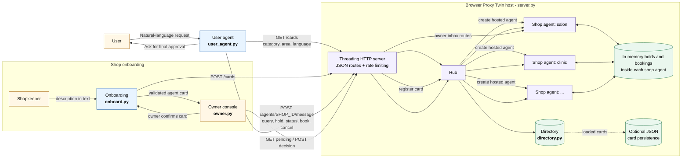
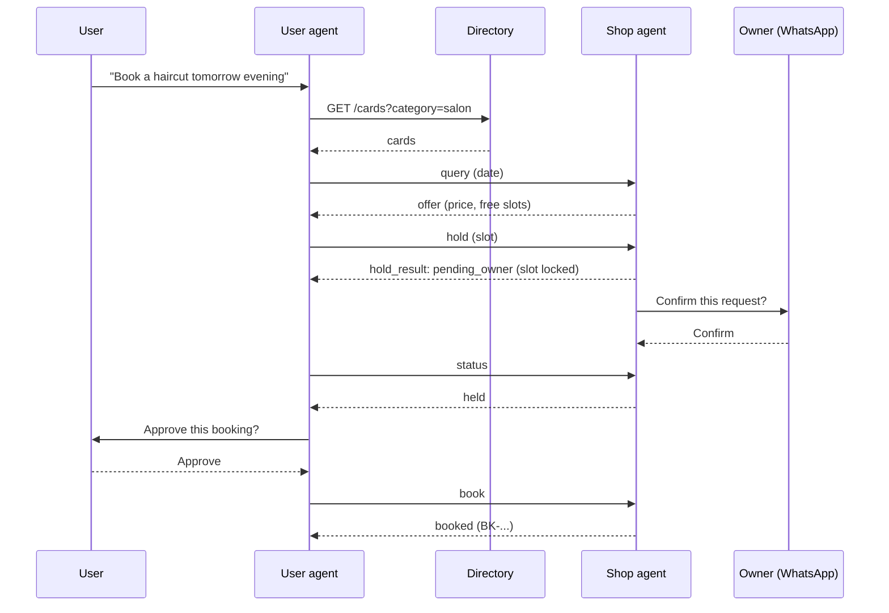

# Architecture

## Components

| Component | File | Responsibility |
|---|---|---|
| Agent card | `schema.py` | Validate a card and generate its slots for a date |
| Directory | `directory.py` | Store cards, search by category, area, language |
| Shop agent | `shop_agent.py` | Answer from the card, lock slots, manage holds, never double-book |
| Server | `server.py` | HTTP routes, one hosted shop agent per card, rate limiting |
| User agent | `user_agent.py` | Parse the request, discover, compare, negotiate, book |
| Onboarding | `onboard.py` | Turn a description into a card; the owner confirms before publishing |
| Owner console | `owner.py` | Stand-in for the WhatsApp confirmation |

## One booking, step by step

If the owner declines, the hold is released and the user agent moves to the next-best shop.

## Design decisions

- **Hold before asking the owner.** The slot is locked the moment a hold is created. Two agents racing for the same slot cannot both win (see `test_concurrent_holds_never_double_book`).
- **Holds expire.** An owner who never answers cannot block a slot forever; the user agent times out and tries the next shop.
- **The owner channel is separate from the protocol.** Swapping the console for WhatsApp, SMS or a voice call changes one adapter, not the agents.
- **Standard library only.** Anyone can run it with Python 3.10+ and no install step.
- **Rule-based onboarding for now.** It keeps the prototype dependency-free and testable. The LLM version replaces `parse_description` and keeps the same output (a validated card).
- **Minimum data shared.** Agents exchange an opaque `customer_ref`, not names or phone numbers.

## Scaling path

- Directory to a database with geo and category indexes; shop agents to stateless workers with holds in the database.
- Federated directories so regional registries can interoperate.
- Channel adapters (WhatsApp Business API, SMS, IVR) behind the owner interface.
