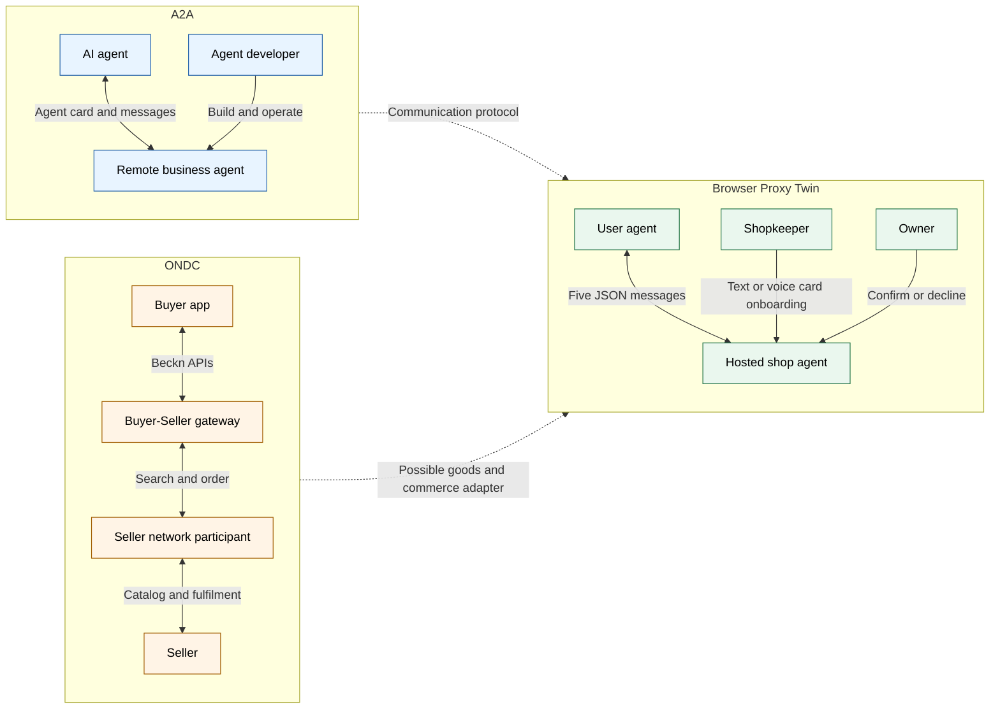

# How this differs from existing approaches

*These summaries describe public information about each approach. Check each one against its current documentation before presenting, because they change quickly.*

| | Browser Proxy Twin | Browser agents | Google Business Profile | WhatsApp Business | ONDC | A2A / MCP |
|---|---|---|---|---|---|---|
| Business needs a website | No | Yes | No | No | No | No |
| Business needs a developer or server | **No** (hosted agent) | No | No | No | Usually onboarding via a network participant | **Yes** |
| Machine-readable prices and slots | Yes | Scraped from pages | Limited | No | Yes (catalogs) | Yes |
| Agent can book directly | Yes | Yes, but slowly | No | No | Yes (mostly goods) | Yes |
| Fits services (clinics, salons, offices) | Yes | Depends on the site | Information only | Chat only | Mainly goods | Yes |
| Onboarding in local language by voice or text | Yes (prototype: text) | No | Partial | Chat | Limited | No |
| Owner confirms each booking | Built in | No | No | Manual | Varies | Not built in |
| Open, no commission | Yes | Yes | Platform-owned | Platform-owned | Open network | Open |

**A2A and MCP solve how agents talk. We solve how a business with no technical skill becomes an agent at all.**

- A2A lets agents describe themselves with a card and exchange messages, and MCP connects agents to tools. Both assume that someone runs and maintains a server for the business. For a kirana store or a tailor, nobody does. Our hosted shop agent plus two-minute onboarding fills that gap.
- Our card and messages are deliberately thin and A2A-shaped, so a hosted shop can later be exposed as an A2A or MCP endpoint through an adapter (on the roadmap). We layer on standards; we do not compete with them.
- **ONDC** is an open network for e-commerce, built around catalogs and orders, where sellers usually onboard through a network participant's app. We focus on appointments, queries and services (clinic slots, salon visits, ward-office document checks) and on businesses that will never fill in a catalog. The two are complementary: a kirana store could appear on both.
- **Google Business Profile and WhatsApp Business** are built for humans to read or chat with. An agent still cannot ask "is 5 pm free, and what will it cost?" and get a structured, bookable answer.
- **Browser agents** work only where a website exists, and they break when the page changes.

## A2A vs ONDC

| Dimension | A2A | ONDC |
|---|---|---|
| Primary purpose | Let autonomous agents discover and communicate with other agents | Create an open, interoperable retail and services network |
| Core units | Agent cards, tasks, artifacts, messages and subscriptions | Buyer apps, seller apps, network gateways and Beckn transactions |
| Discovery | Clients discover an agent and inspect its card or capabilities | Buyer applications search the network and aggregate catalog responses |
| Transaction model | Protocol agnostic; an agent or application defines the task lifecycle | Structured search, select, init, confirm and status flows for commerce |
| Interoperability | Standardizes agent-to-agent interaction, not a domain business schema | Standardizes network participants and domain transaction protocols |
| Business onboarding | The business or developer must publish and operate an agent endpoint | Sellers join through a network participant or seller application |
| Best fit | General-purpose delegation between capable software agents | Indian digital commerce with multiple interoperable buyer and seller participants |
| Human-in-the-loop | Not defined by the protocol itself; the application must add it | Available through buyer/seller applications and network workflows |
| Payments | No universal payment or settlement workflow built into A2A | Commerce, payment and fulfilment can be integrated through participating systems |
| Identity and authorization | Agent card metadata plus application-selected authentication | Network participant identity, authorization and transaction-level trust |

**Relationship to Browser Proxy Twin:**

- A2A is the closest agent-communication pattern. Browser Proxy Twin uses a smaller, service-specific HTTP protocol and could expose hosted shop agents through an A2A adapter.
- ONDC is the closest commerce-network pattern. It already provides open network and catalog concepts, but onboarding and transaction flows are generally too heavy for a zero-tech, appointment-driven shop.
- The project does not replace either standard. It can act as an onboarding and hosting layer, while adapters translate its cards and five messages into A2A or an appropriate commerce protocol.

## What we are honest about

- Our protocol is v0.1 and small on purpose; it is a proof of concept, not a finished standard.
- Cold start is the biggest risk: cards need agents asking, and agents need cards to find. The plan is to seed one town, ship our own user agent as the first consumer, and open the directory API for others.
- Phone verification, real WhatsApp and an LLM onboarding flow are roadmap items, not shipped (see the README).
